# 「宠物家」小程序流程拆解
### 附：自家寄养小程序（P0）需求说明

> 用途：给外包 / 设计师的需求文档
> 素材：微信小程序「宠物家 Petem」25 张截屏（测试账号，门店"朗琴园"）
> 版本：2026-11-04 · v1.0

---

## 0. 先给自己的一页话（找外包之前，先看这页）

**顺序别搞反：先用 Vibe Coding 做出一个能点的演示版，自己试用通过，再去谈外包。**

只拿一份文档去找外包，你会在三个地方吃亏：

1. 你判断不了文档写得对不对——外包说"做完了"，你没有对照物。
2. 外包理解的"寄养预约"和你脑子里的不是一回事，返工的钱全算在你头上。
3. 报价没有锚点——手里没有实物，只能听他说多少钱。

所以正确顺序是：

| 步骤 | 做什么 | 花多久 | 通过标准 |
|---|---|---|---|
| ① | 用 Vibe Coding 生成演示版：一个微信小程序，**同时具备客户模式和店主模式**（店主模式就是你的管理端） | 1–2 天 | 能在你自己手机上打开，能从头点到尾 |
| ② | 自己当**客户**跑一遍：建档 → 选日期 → 提交预约 → 看订单 | 20 分钟 | 60 秒内订上，不需要别人教 |
| ③ | 自己当**店主**跑一遍：收到预约 → 确认 → 发日报 → 点完成 | 20 分钟 | 每一步都能一只手在手机上做完 |
| ④ | 通过了再交给外包：**可点的原型 + 本文档 + 一段手机录屏** | — | 外包看完能复述你的完整流程 |

**演示版的边界（交出去时一定要说清）**：

- 它只是**原型**：数据是假的，不能收款，不能存真实客户信息，别拿它接单。
- 它的价值是把"我要什么"变成"你看这个"——能省掉八成的扯皮。
- 交给外包时只说一句：**"流程照这个做，界面重做，代码不用。"**

**为什么这一步最值钱**：文档会写错，原型不会。你在自己手机上点一遍，哪里别扭立刻就知道——这比外包做完再改便宜十倍。

---

## 0.5 给外包的一页话

**做什么**：一个社区宠物寄养店的自用小程序。客户能建档、看空档、下单预约、看每日照片；店主能确认订单、发日报。三件事：**预约、档案、订单**。

**不做什么**：不做商城、不做内容社区、不做会员等级、不做储值卡、不做发票、不做在线支付、不做多门店、不做自建 IM。

**导航**：底部 3 个 tab（首页 / 订单 / 我的）+ 一个悬浮"预约寄养"按钮。

**交付物**：可上线的小程序（含管理端/店主模式），源码交付，配合完成微信审核。

**验收**：见文末附录 C，每个 P0 页面 3 条，逐条演示。

**分期**：P0 先上（见第 9 章）。P1、P2 报价时分开报，不要捆在一起。

**配套材料**：随本文档附一份**可点的演示原型**（客户模式 + 店主模式）。流程以原型为准，视觉一律重做。

**素材说明**：文中截屏全部来自竞品，只用于说明**信息结构**。视觉、文案、图标、配色一律重做，不得临摹。

---

## 1. 怎么读这份文档

- **S01–S25** 是截屏编号，附录 A 有"编号 ↔ 原文件名"对照表。
- 图上的**红框 + 数字**表示"这一点可以点"，数字对应下方的表格行。
- **⚠️ 缺图**：这一步在竞品里有，但我没截到，或它压根没有。缺的地方我会写清楚"应该有什么"，那部分是**建议稿**，不是实拍证据。
- **🏠 给你的店**：这一屏值不值得抄、怎么改。这是给店主看的，外包可以跳过，但**别抄错方向**。
- 同一页的不同状态（比如订单的 4 个 tab、发票的 3 个 tab）我会并排放，它们**不是**不同页面。

---

## 2. 全局地图

### 2.1 一句话结构

宠物家是"**服务货架 + 内容社区 + 会员制**"的连锁店模型：首页用来种草，服务页用来卖套餐，会员用来锁客。
你的店是"**预约制 + 单点服务**"：客户一年来不了几次，来的时候只关心三件事——**有没有位置、多少钱、我的狗怎么样**。所以照抄它的骨架会把你拖进一个你养不起的结构。

### 2.2 页面清单（17 页 / 25 屏）

| 区域 | 页面 | 截屏 | 性质 |
|---|---|---|---|
| 进店 | 首页 | S01 S02 S03 | 一页三屏（滚动） |
| 进店 | 门店与地址选择 | S04 | 独立页 |
| 建档 | 管理宠物 | S05 | 独立页（空态） |
| 建档 | 建立档案 | S06 | 独立页（表单） |
| 选服务 | 服务 tab | S07 S08 | 一页两态（胶囊切换） |
| 选服务 | 订单页 | S09 S10 S11 | 一页四 tab（商城缺图） |
| 我的 | 我的 | S12 | 独立页 |
| 我的 | 养宠动态 | S13 | 独立页（空态） |
| 我的 | 宠物日历 | S14 | 独立页 |
| 售后 | 发票中心 | S15 | 入口页 |
| 售后 | 开票列表 | S16 S17 | 一页两 tab |
| 售后 | 开票历史 | S18 | 独立页（空态） |
| 售后 | 发票须知 | S19 | 静态长文 |
| 售后 | 反馈与建议 | S20 S21 S22 | 一页三 tab |
| 我的 | 系统设置 | S23 | 独立页 |
| 售后 | 客服会话 | S24 | 微信客服 |
| 会员 | Prime 会员 | S25 | 独立页 |

### 2.3 跳转关系（主干）

~~~text
首页 S01
 ├─① 门店胶囊 ──────────→ S04 门店选择 ──(选定)──→ 返回首页
 ├─② 添加宝贝信息 ──────→ S05 管理宠物 ──→ S06 建立档案 ──(保存)──→ S05
 ├─  立即入会 ───────────→ S25 Prime 会员
 ├─③ 服务 tab ──────────→ S07 服务页 ──①──→ S08 我的服务（同页另一态）
 ├─④ 订单 tab ──────────→ S09 订单·服务 ──→ S10 卡券 / S11 寄养
 └─⑤ 我的 tab ──────────→ S12 我的
                             ├─ 我的宠物 ──→ S05
                             ├─ 养宠动态 ──→ S13
                             ├─ 宠物日历 ──→ S14
                             ├─ 我的评价 ──→ ⚠️ 缺图
                             ├─ 账单 ──────→ ⚠️ 缺图
                             ├─ 发票查询 ──→ S15 ──→ S16 / S17 / S18 / S19
                             ├─ 反馈与建议 → S20 / S21 / S22
                             ├─ 设置 ──────→ S23
                             └─ 联系客服 ──→ S24
~~~

---

## 3. 第一章｜进店：先把人拦住

客户第一次进来，只会在首页待 5–8 秒。这一章回答：**他在这 8 秒里该看到什么，下一步点哪。**

### 3.1 S01–S03 首页（同一页，向下滚动三次截的）

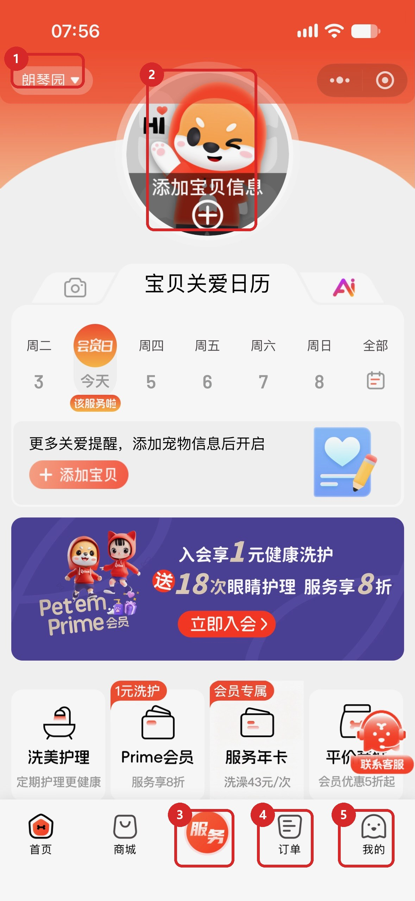 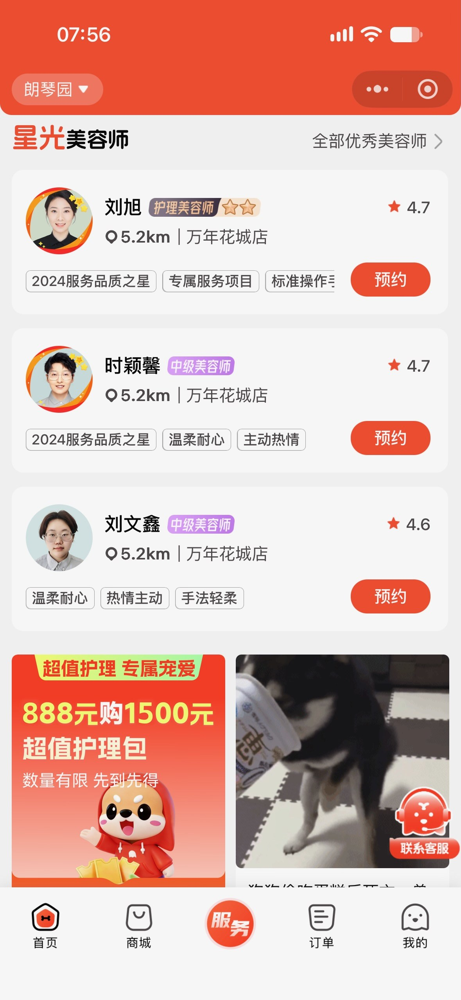 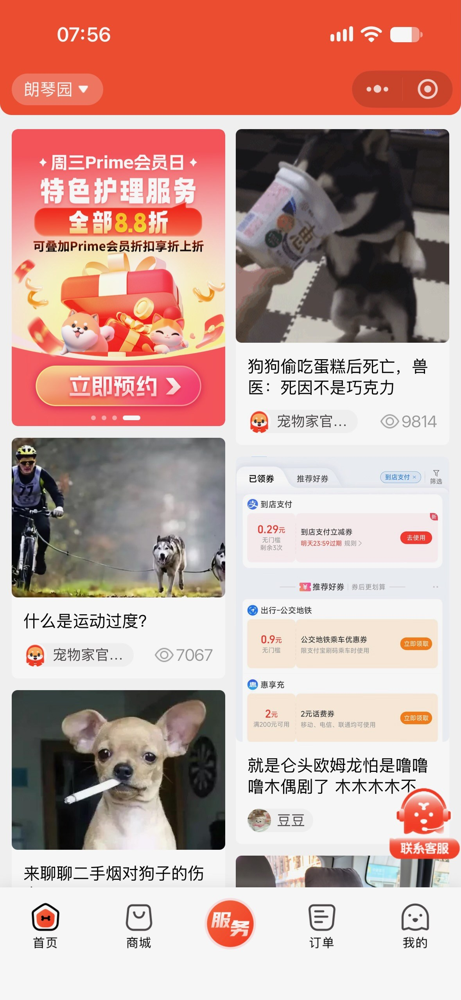

*S01 顶部 / S02 中段 / S03 下段 —— 三张的底部导航完全一致，顶部门店胶囊也一致；S02 底部的两张广告卡在 S03 顶部原样出现，说明是同一页滚动。*

**S01 的出口：**

| # | 点哪里 | 去哪 | 说明 |
|---|---|---|---|
| ① | 左上"朗琴园 ▾" | S04 门店选择 | 全站唯一的位置上下文，改一次全站生效 |
| ② | 中间"添加宝贝信息 +" | S05→S06 建档 | 新人第一次来必点的东西，占了首屏正中央 |
| ③ | 底部"服务"（凸起圆钮） | S07 服务页 | 全站的主转化入口，凸起是为了不用找 |
| ④ | 底部"订单" | S09 订单页 | |
| ⑤ | 底部"我的" | S12 我的 | |

**这屏上还有什么**（无编号，次要）：

- **宝贝关爱日历**：左边相机、右边 AI 两个小入口；周历带"会员日"角标和"今天·该服务啦"提示；未建档时灰掉，写着"更多关爱提醒，添加宠物信息后开启"。**这是一个把"提醒"卖给你的模块**，本质是提高复购频次。
- **Prime 会员横幅**：入会享 1 元洗护、送 18 次眼睛护理、服务 8 折、「立即入会」。首屏第二屏就放会员广告，宠物家的商业重心在这里。
- **四宫格**：洗美护理 / Prime 会员 / 服务年卡 / 平价商城，每格带角标（1 元洗护、会员专属、¥43/次）。
- **S02 星光美容师**：三张技师卡，字段是 头像、姓名、等级徽章、评分 4.7、距离 5.2km、门店、三个标签（2024 服务品质之星 / 温柔耐心 / 手法轻柔）、「预约」按钮。**这是在卖"人"**，不是卖服务。
- **S02 广告位**：左"888 元购 1500 元超值护理包"，右用户视频卡。
- **S03 内容流**：双列瀑布流，文章标题 + 作者 + 阅读数（9814 / 7067），穿插**领券中心**（已领券 / 推荐好券：支付宝到店立减 0.29 元、公交地铁券、话费券）。
- **悬浮客服**：右下角企鹅头，全站常驻。

> 🏠 **给你的店**
> 1. **只留两个动作**：一个「预约寄养」大按钮（占首屏中央），一个「我的订单」。其余模块全部后置。
> 2. **②"添加宝贝信息"的位置要留**。它是新客唯一的必经动作，而你做寄养比宠物家更依赖它——没有体重和疫苗信息，你根本没法报价和接狗。
> 3. **日历模块可以留，但换个用途**：宠物家卖"提醒"，你要卖"**这周还剩几个位置**"。同一个位置，一个是复购钩子，一个是库存提示，后者对你更值钱。
> 4. **星光美容师 → 换成"照顾你狗的人"**。你就一个人，那就把你自己放上去：照片、养宠年限、擅长什么犬种、一句实话（比如"每天最多接 3 只，接满就停"）。一人店最大的劣势是没品牌，最大的优势是**可追责的具体的人**。
> 5. **内容流、领券中心、广告位、四宫格：全砍**。你产不出内容，也没券可发；四个宫格里三个是卖货入口，你一个都不开。
> 6. S02/S03 这两屏唯一值得抄的是**"标签"这个手法**：三五个短标签比一段介绍有效十倍。

### 3.2 S04 门店与地址选择

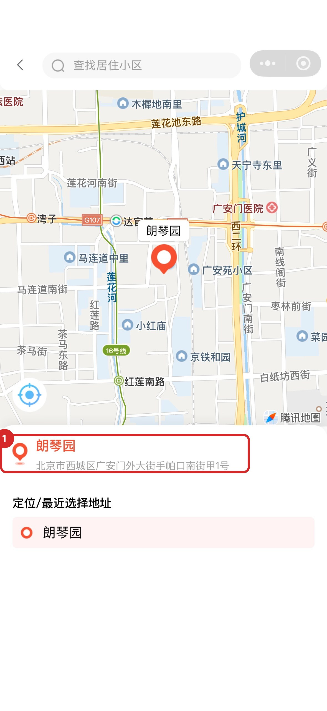

**这屏是什么**：搜索框"查找居住小区" + 腾讯地图 + 当前门店卡（店名"朗琴园"、地址"北京市西城区广安门外大街手帕口南街甲1号"）+ 顶部"定位/最近选择地址"与已选中的门店行。

**出口：**

| # | 点哪里 | 去哪 | 说明 |
|---|---|---|---|
| ① | 门店行"朗琴园" | 返回 S01 | 选定后全站价格、库存、技师都跟着换 |

**🗑 缺图**：地图上其他门店的标记点、搜索结果列表页。

> 🏠 **给你的店**
> **整页砍掉。** 你只有一家店，做地址选择只会让人以为你有分店。改成：首页顶部固定一行「北京市西城区 XX 小区 X 号楼 · 步行 5 分钟 · 一键导航」，点了直接调起微信内置地图。
> 唯一要保留的是**地址的写法**：门牌 + 参照物 + 步行时间。寄养客户是拎着猫包来的，找不到门就是差评。

---

## 4. 第二章｜建档：寄养的真正门槛

宠物家的建档是给"洗美"设计的（肩高决定浴缸大小）。**寄养要的是另外一套字段**，这一章是全文改动最大的地方。

### 4.1 S05 管理宠物（空态）

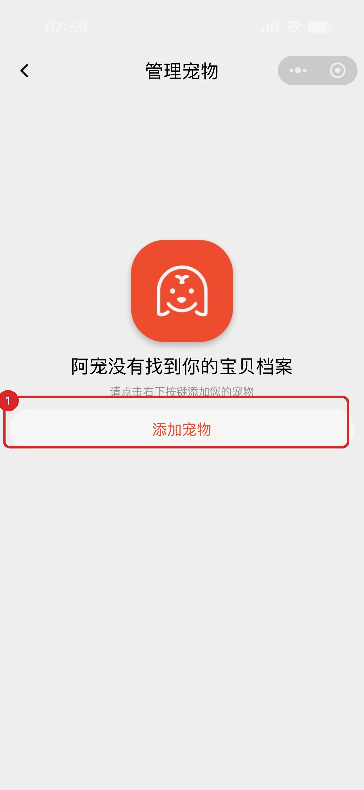

**这屏是什么**：标题「管理宠物」，中间一只狗的插画，文案"阿宠没有找到你的宝贝档案 / 请点击右下按键添加您的宠物"，底部一个大按钮「添加宠物」。空态画得很轻，但按钮够大。

**出口：**

| # | 点哪里 | 去哪 | 说明 |
|---|---|---|---|
| ① | 添加宠物 | S06 建立档案 | 唯一的出口 |

> 🏠 **给你的店**
> 保留，但**别让它成为孤岛**：下单时如果没有档案，应该在这里**拦一下**并直接跳建档，填完自动回到下单页。宠物家的流程里这一步是断的——你必须从"我的"里主动去找。

### 4.2 S06 建立档案（表单）

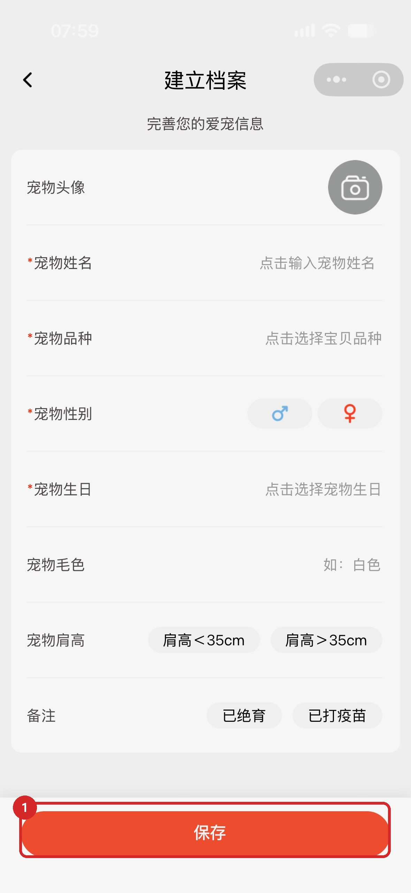

**字段清单（原样）**：

| 字段 | 必填 | 形态 | 说明 |
|---|---|---|---|
| 宠物头像 | 否 | 上传 | 圆形，右侧相机图标 |
| 宠物姓名 | 是 | 文本 | 占位"点击输入宠物姓名" |
| 宠物品种 | 是 | 选择器 | 占位"点击选择宝贝品种" |
| 宠物性别 | 是 | 二选一 | ♂ / ♀ 图标按钮 |
| 宠物生日 | 是 | 日期 | 用来推"该驱虫/该洗澡" |
| 宠物毛色 | 否 | 文本 | 占位"如：白色" |
| 宠物肩高 | 否 | 二选一 | 「肩高 < 35cm」「肩高 > 35cm」 |
| 备注 | 否 | 标签 | 「已绝育」「已打疫苗」两个可点标签 |

**出口：**

| # | 点哪里 | 去哪 | 说明 |
|---|---|---|---|
| ① | 底部"保存" | 返回 S05 | 保存后列表出现新宠物 |

> 🏠 **给你的店 —— 这张表要重做**
> 宠物家的字段服务于洗美：**肩高**决定进哪个浴缸，**毛色**给美容师看，**生日**用来推洗澡提醒。
> 寄养要的是：**体重**（决定报价）、**疫苗本照片 + 有效期**（出事时的唯一凭证）、**是否绝育**（决定能不能和其他狗同处）、**性格 / 是否怕生 / 能不能群养**、**喂食量与习惯**、**既往病史与在用药**、**紧急联系人**。
> 但**不要一次问完**（同意你之前的选择）：首单只填 4 项 —— **姓名、品种、体重、疫苗照片**；其余放进"接宠前补"，到店当面填，你不增加工时，客户也不被表单劝退。
> 另外：**保存按钮要能"先存再补"**，不要做全字段校验，否则客户填到一半就跑了。

---

## 5. 第三章｜选服务：宠物家的货架 vs 你的单点

### 5.1 S07 / S08 服务 tab（一页两态）

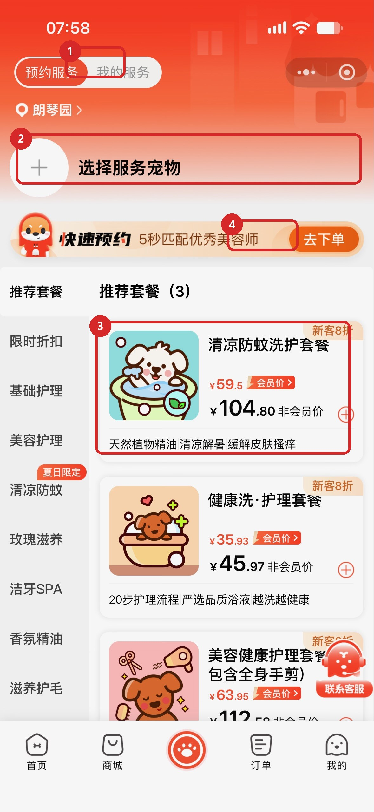 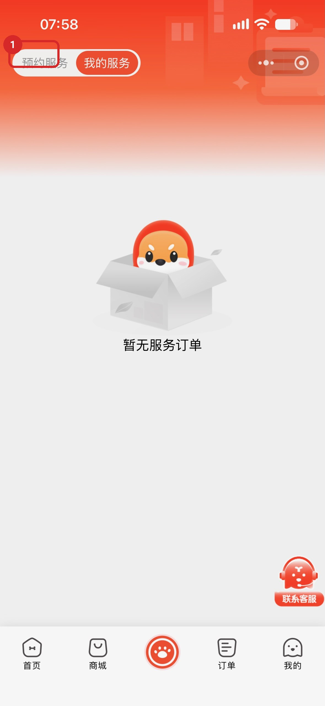

*左边是「预约服务」，右边是「我的服务」——同一个页面的胶囊切换，不是两个页面。*

**S07 的出口：**

| # | 点哪里 | 去哪 | 说明 |
|---|---|---|---|
| ① | 顶部胶囊「我的服务」 | S08 | 同一页切态 |
| ② | 选择服务宠物 条 | ⚠️ 缺图 | 气泡里是空头像 + "选择服务宠物"，点开应是宠物列表 |
| ③ | 任一「套餐卡」 | ⚠️ 缺图 | 应该是套餐详情 / 直接下单页 |
| ④ | 快速预约条的「去下单」 | ⚠️ 缺图 | 5 秒匹配美容师的快捷通道 |

**这屏上还有什么**：

- **左侧竖排分类栏**：推荐套餐 / 限时折扣 / 基础护理 / 美容护理 / 清凉防蚊 / 玫瑰滋养 / 洁牙 SPA / 香氛精油 / 滋养护毛 —— 这是电商式的 SKU 导航。
- **套餐卡字段**：商品图、套餐名、右上角"新客 8 折"、划线会员价 ¥59.5、主价 ¥104.80、非会员价标签、一行卖点文案、右下角"＋"加购。
- **S08 空态**：一句"暂无服务订单"，没有按钮、没有引导。

> 🏠 **给你的店**
> 1. **货架整个砍掉**。你不卖 9 个品类，你只卖一件事：狗/猫住几晚。左侧分类栏、套餐卡片、加购"＋"全部不要。
> 2. **换成单页表单**：选宠物（无档案先建档）→ 选入住日期 → 选离店日期 → 显示"共 N 晚，预估 ¥XXX" → 提交。一屏完成，不跳页。
> 3. **保留"选择服务宠物"这个交互**——它决定了报价和笼位，是必填项。
> 4. **S08 那个空态是反面教材**：没有 CTA 的空态等于死胡同。你的每一个空态都必须带一个按钮（「去预约」/「去建档」）。

### 5.2 S09–S11 订单页（一页四 tab，商城缺图）

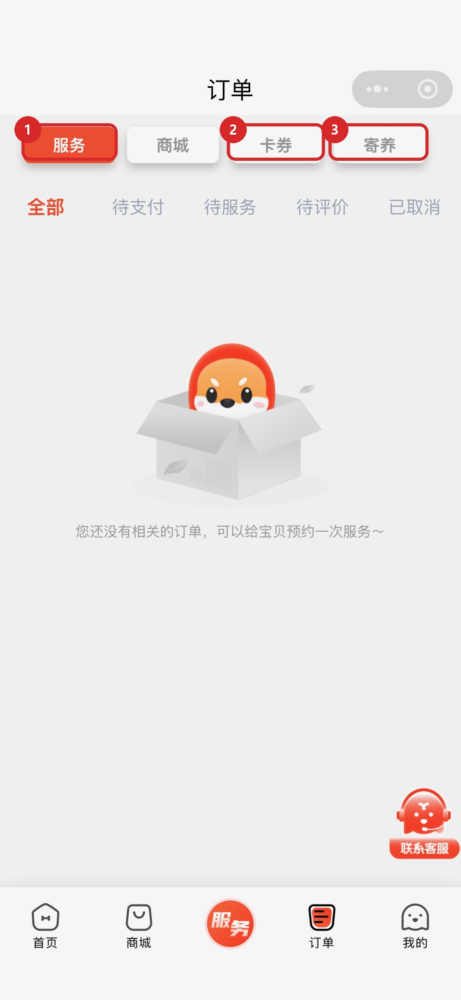 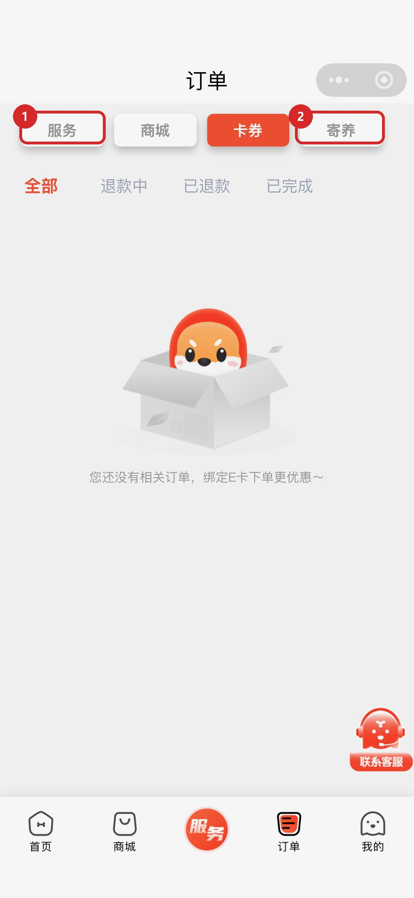 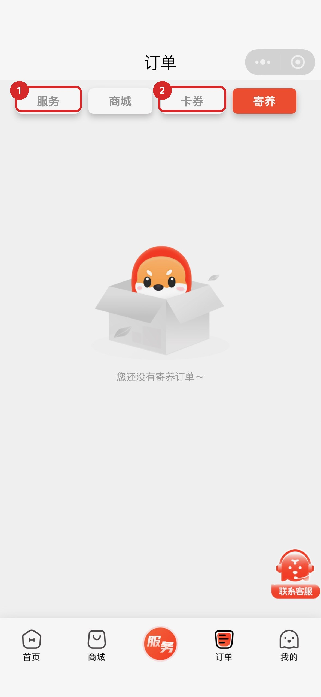

*S09 服务 / S10 卡券 / S11 寄养 —— 同一个订单页切了 4 个 tab（"商城"那张没截，且你也不做）。*

**结构**：

- **一级 tab**：服务 / 商城 / 卡券 / 寄养
- **二级状态**：全部 / 待支付 / 待服务 / 待评价 / 已取消
- **空态文案**：服务"您还没有相关的订单，可以给宝贝预约一次服务～"、寄养"您还没有寄养订单～"
- 每屏右下角常驻悬浮客服

**出口：**

| # | 点哪里 | 去哪 | 说明 |
|---|---|---|---|
| ① | 一级 tab「服务」 | S09 | |
| ② | 一级 tab「卡券」 | S10 | |
| ③ | 一级 tab「寄养」 | S11 | |

**⚠️ 缺图**：有订单时的列表样式、订单详情页、取消/退款流程。

> 🏠 **给你的店**
> 1. **一级 tab 只留两个：寄养 / 次卡**。商城、服务、卡券三选二都砍。
> 2. **二级状态不能照抄**。宠物家是洗美逻辑（待支付→待服务→待评价）；寄养是**时间轴逻辑**：待确认 → 待入住 → 入住中 → 已完成 → 已取消。少一个"入住中"，客户在狗住店的那 5 天里打开小程序什么都看不到。
> 3. **S11 那个空态是个具体的 bug**：写着"您还没有寄养订单～"，却没有任何按钮。你的版本必须是「还没有寄养订单 → 去预约」。
> 4. 悬浮客服保留，但换成"联系店主"，点了直接进微信客服会话（S24 那种）。

---

## 6. 第四章｜下单与支付（⚠️ 全段缺图）

**这一整章没有任何实拍。** 我在宠物家里点进套餐就停了，没有走完下单流程，也没截支付页。所以下面全部是**建议稿**——不是宠物家的做法，是"你这门生意该怎么做"。

### 6.1 缺的是什么

| 缺的页面 | 为什么必须有 |
|---|---|
| 服务/套餐详情页 | 客户要看清楚"包不包洗澡、包不包粮" |
| 选宠物页 | 决定报价和笼位 |
| 选时间页 | 寄养是按晚算的，必须有日历区间选择 |
| 订单确认页 | 金额、接送、备注、取消规则 |
| 支付页 | P0 **不做**，见下 |
| 预约成功页 | 最关键的一屏，客户在这里确认"我订上了" |

### 6.2 P0 建议方案：一页表单，不做购物车

**页面：预约寄养（单页）**

| 区块 | 内容 | 必填 |
|---|---|---|
| 宠物 | 头像 + 名字 + 体重，右侧"更换"；无档案时显示「去建档」 | 是 |
| 入住日期 | 日期选择，默认今天之后 | 是 |
| 离店日期 | 日期选择，自动算晚数 | 是 |
| 合计 | "共 5 晚 · 预估 ¥400"（体重 × 单价 × 晚数） | 自动 |
| 接送 | 开关「需要接送」+ 地址 | 否 |
| 备注 | 喂食、用药、性格提醒 | 否 |
| 提交 | 「提交预约」 | — |

**提交之后（这一段最容易被外包做错，请照着做）**：

1. 生成订单，状态 = **待确认**（不是"待支付"）。
2. 立刻给客户一屏：「已提交，店主会在 2 小时内确认」+ 订单号 + 你的电话。
3. 同时给你（店主）推一条**微信订阅消息**。
4. 你在"店主模式"里点「确认」→ 客户收到"已确认，请于 X 月 X 日 10:00 前送到"。
5. 若你要改价或没位置 → 点「改价」/「拒绝」，客户收到对应通知。

**明确不做**：

- ❌ 在线支付（商户号、退款、对账，对一人店是纯负担；档期锁定靠"确认"而不是"付款"）
- ❌ 优惠券、余额、积分
- ❌ 购物车（寄养不是多件商品）

> 🏠 **给你的店**：这一页是整个小程序的核心。**其他页面都可以简陋，这一页不能**。判断标准只有一条：一个 50 岁的客户，不问你，能不能在 60 秒内订上。

---

## 7. 第五章｜到店与履约（⚠️ 全段缺图）

寄养最值钱的不是下单，是**狗住进来之后的那 5 天**。宠物家在这一段完全空白（它做的是到店洗美，2 小时结束），所以这一章同样全是建议稿——**也正因为是空白，这里才是你能做出差异的地方**。

### 7.1 缺的是什么

到店核销、入住确认、每日反馈、离店结算、评价——一张都没有。

### 7.2 P0 建议方案：三段式

**① 入住（到店 1 分钟）**

- 客户出示订单页的二维码 → 你扫 → 订单状态变「入住中」。
- 或你在店主模式手动点「已入住」。
- 同时触发一条系统消息给客户：「豆豆已入住，笼位 A3，今天开始每天给你发照片」。

**② 每日反馈（你每天 30 秒）**

- 店主模式首页显示"今日待发日报：3 只"。
- 点进去：**选模板**（吃得好/有点紧张/玩得开心）→ **选 2–3 张照片** → 发送。
- 客户在订单详情里看到一条时间线：Day1 / Day2 / Day3 …，每条含照片 + 一句话。
- 这是**留存和转介绍的发动机**，也是你区别于"笼子寄存"的唯一证据。

**③ 离店（1 分钟）**

- 你点「已完成」→ 生成结算页（实际晚数、接送费、加项）→ 客户看到"本次寄养 5 晚"。
- 附带两个按钮：「再约一次」「推荐给朋友」。
- 此时才引导评价——**不要在入住期间弹评价**。

> 🏠 **给你的店**
> 1. 日报模板必须**只有 3 个选项、一句话、2 张图**。任何需要打字的环节你都会放弃。
> 2. 客户能不能看到"我家狗现在什么样"，是寄养和"扔在宠物店笼子里"的全部区别。这一条比首页好看重要十倍。
> 3. S13"养宠动态"那个壳（发照片 + 时间线）可以直接搬过来当日报页，宠物家拿它做社区，你拿它做服务记录，同一个组件两种用法。

---

## 8. 第六章｜我的与售后：抄三成，砍七成

宠物家的"我的"是一个**电商用户中心**（卡包、服务券、罐头币、商品券、账单、发票、评价）。你只需要其中三样。

### 8.1 S12 我的

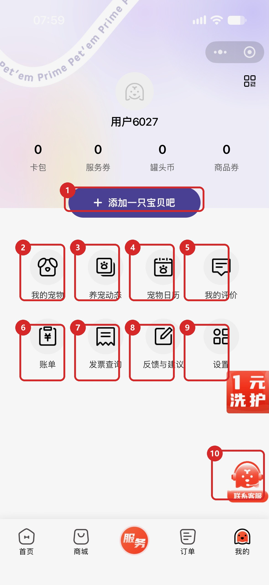

**这屏是什么**：顶部头像 + 昵称"用户6027"、右上扫码；四宫格数字（卡包 / 服务券 / 罐头币 / 商品券，全部为 0）；一条「＋ 添加一只宝贝吧」；两行共 8 个功能入口；右下悬浮客服；页面上还压了一张"1 元洗护"的浮动广告。

**出口：**

| # | 点哪里 | 去哪 |
|---|---|---|
| ① | ＋ 添加一只宝贝吧 | S05 管理宠物 |
| ② | 我的宠物 | S05 |
| ③ | 养宠动态 | S13 |
| ④ | 宠物日历 | S14 |
| ⑤ | 我的评价 | ⚠️ 缺图 |
| ⑥ | 账单 | ⚠️ 缺图 |
| ⑦ | 发票查询 | S15 |
| ⑧ | 反馈与建议 | S20 |
| ⑨ | 设置 | S23 |
| ⑩ | 联系客服 | S24 |

> 🏠 **给你的店**
> **八宫格砍到四个**：我的宠物 / 我的订单 / 我的次卡 / 联系店主。
> 顶部的"卡包 / 服务券 / 罐头币 / 商品券"四组数字**全部删掉**——它们是电商积分体系的门面，你没有这套账。
> 但**头像 + 昵称 + 手机号**要留，寄养是要认人的生意。

### 8.2 S13 养宠动态（空态）

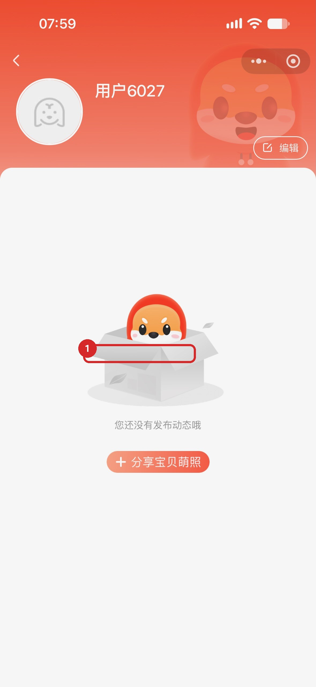

**这屏是什么**：用户主页（头像 + "用户6027" + 编辑按钮），空态插画 + "您还没有发布动态哦" + 「＋ 分享宝贝萌照」。

**出口：** ① 分享宝贝萌照 → ⚠️ 缺图（发布页）

> 🏠 **给你的店**：作为"社区"砍掉；作为"日报"复用（见第 7 章）。

### 8.3 S14 宠物日历

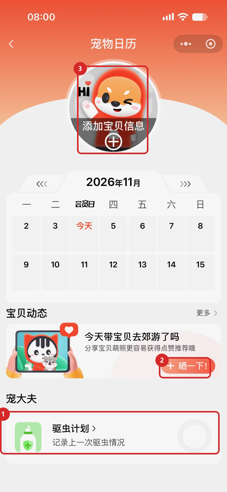

**这屏是什么**：未建档提示（添加宝贝信息 +）、月历（可左右翻月，含"会员日"和"今天"标记）、「宝贝动态」横滑区（＋晒一下）、「宠大夫」区的"驱虫计划 › 记录上一次驱虫情况"。

**出口：**

| # | 点哪里 | 去哪 |
|---|---|---|
| ① | 驱虫计划 | ⚠️ 缺图 |
| ② | ＋ 晒一下 | ⚠️ 缺图（发布页） |
| ③ | 添加宝贝信息 | S06 建档 |

> 🏠 **给你的店**
> 这个日历**换个用途就是你的核心页面**：让客户看到"我家狗 11/12–11/16 在店"，以及"我上次住了 3 晚、这次该打疫苗了"。
> 宠物家用它推复购，你用它**降低"狗在店里到底怎么样"的焦虑**，顺便提醒疫苗到期——疫苗过期你就不能接，这是硬门槛。

### 8.4 S15–S19 发票中心（四屏，P2 才考虑）

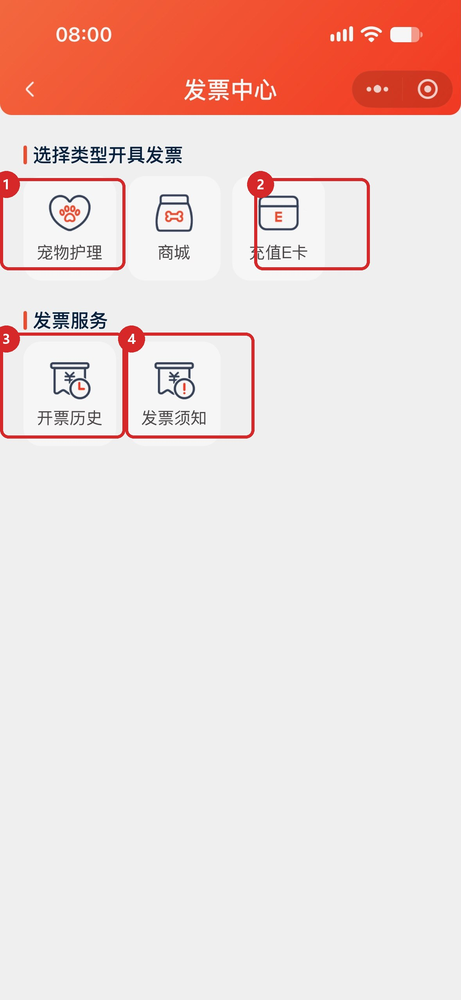 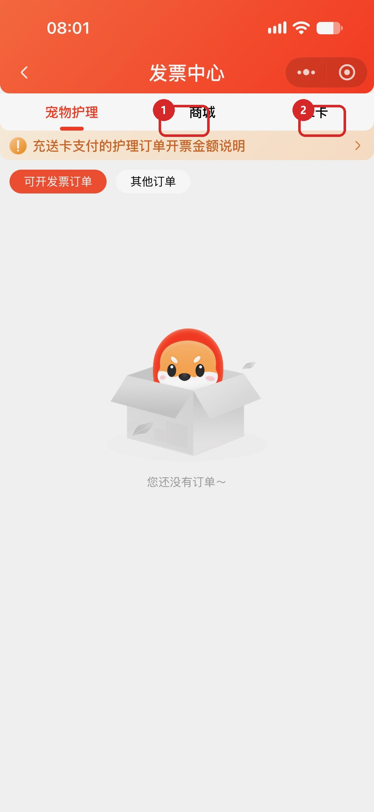 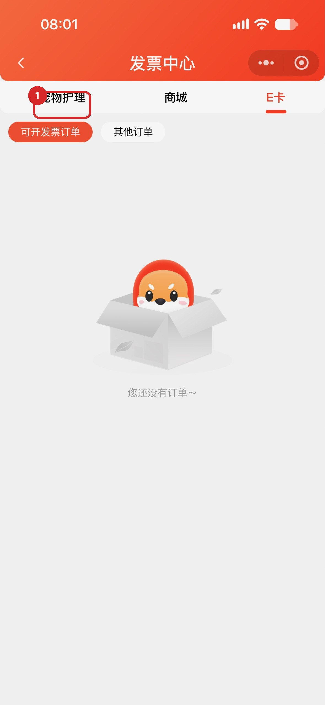

**结构**：

- **S15 入口页**：图标宫格 —— 宠物护理 / 商城 / 充值 E 卡；下方"发票服务"：开票历史 / 发票须知。
- **S16 开票列表·宠物护理**：顶部 tab（宠物护理 / 商城 / E 卡）+ 黄色提示条"充送卡支付的护理订单开票金额说明" + 二级筛选（可开发票订单 / 其他订单）+ 空态。
- **S17 同页 E 卡 tab**：同上，空态。
- **S18 开票历史**：空态。
- **S19 发票须知**：整屏纯文本规则。

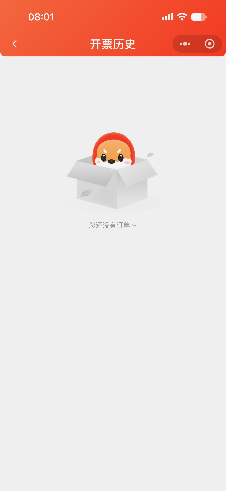 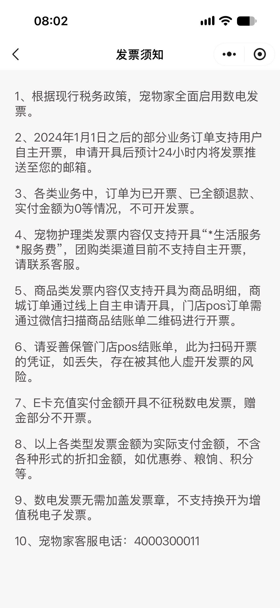

*S18 开票历史（空态）/ S19 发票须知（整屏文字规则，没有任何交互）。*

**出口**：S15 的四个图标分别去 S16 / ⚠️缺图（商城）/ S17 / S18 / S19。

> 🏠 **给你的店**：**全砍。** 个人客户要发票的比例极低，一年几单走微信发电子发票即可。为了这几单做一套开票流程，外包报价至少多五千。

### 8.5 S20–S22 反馈与建议（一页三 tab）

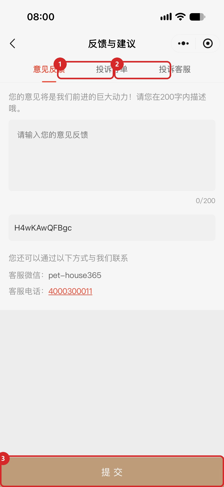 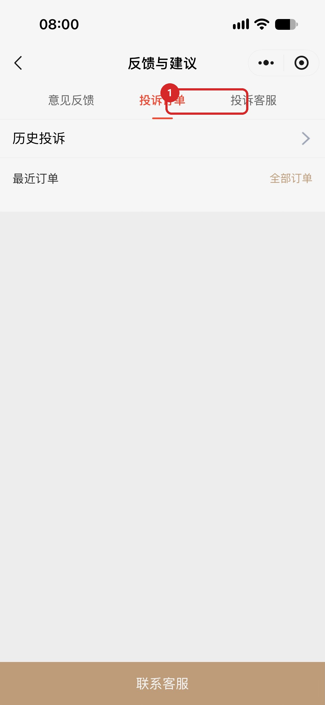 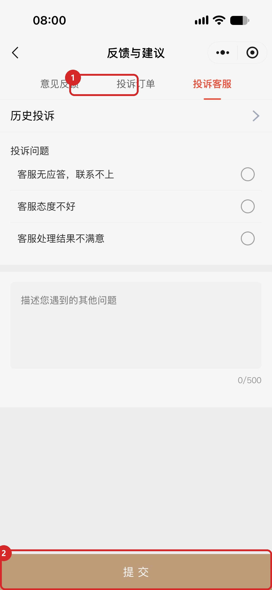

**三个 tab**：

| tab | 内容 |
|---|---|
| 意见反馈 | 200 字上限的输入框 + "您还可以通过以下方式与我们联系" + 客服微信 pet-house365 + 客服电话 4000300011 + 底部「提交」 |
| 投诉订单 | 「历史投诉 ›」+「最近订单 / 全部订单」+ 空态 + 底部"联系客服"条 |
| 投诉客服 | 「历史投诉 ›」+ 3 个单选（客服无应答联系不上 / 客服态度不好 / 客服处理结果不满意）+ 500 字输入框 + 底部「提交」 |

**出口：** ① 投诉订单 tab、② 投诉客服 tab、③ 底部提交。

> 🏠 **给你的店**
> 三个 tab 合并成一页「联系店主」：**问题类型下拉（喂食 / 健康 / 环境 / 其他）→ 一块输入框 → 提交**，提交直接落到你的微信。
> 但这一章透露了一个重要信息：**"客服无应答、联系不上"被单列成一个投诉选项**，说明这是宠物家最高频的怨气。一人店在这件事上天然有优势——你能做到"2 小时内必回"，把它写进小程序首页就行。

### 8.6 S23 系统设置

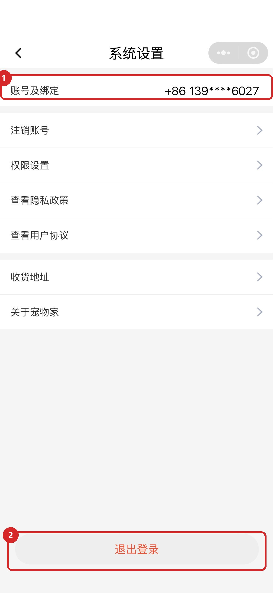

**列表**：账号及绑定（+86 139＊＊＊＊6027，不可点区域）/ 注销账号 / 权限设置 / 查看隐私政策 / 查看用户协议 / 收货地址 / 关于宠物家 / 底部「退出登录」。

**出口：** ① 账号及绑定 → ⚠️ 缺图；② 退出登录 → 回登录态。

> 🏠 **给你的店**
> 七项砍到三项，但**有两项不能砍**：「查看隐私政策」和「注销账号」。微信小程序审核会查这两条路径，缺了会被驳回。（条款以微信最新运营规范为准，建议上线前让外包对照一遍。）

### 8.7 S24 客服会话

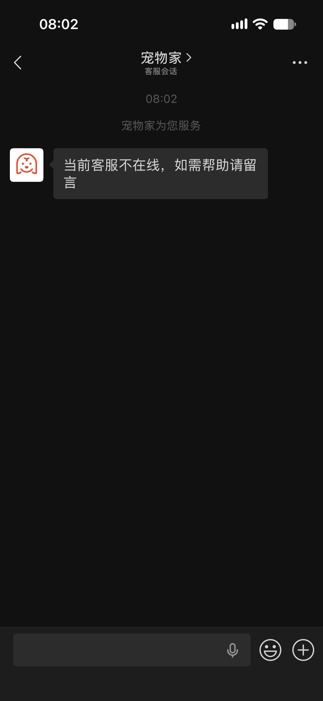

**这屏是什么**：微信原生客服会话窗口（不是自建 IM），带欢迎语和输入框。

> 🏠 **给你的店**：直接用微信客服能力，**不要自建聊天**。自建 IM 要处理消息存储、未读、推送、封禁，是另一个产品的工作量。

### 8.8 S25 Prime 会员

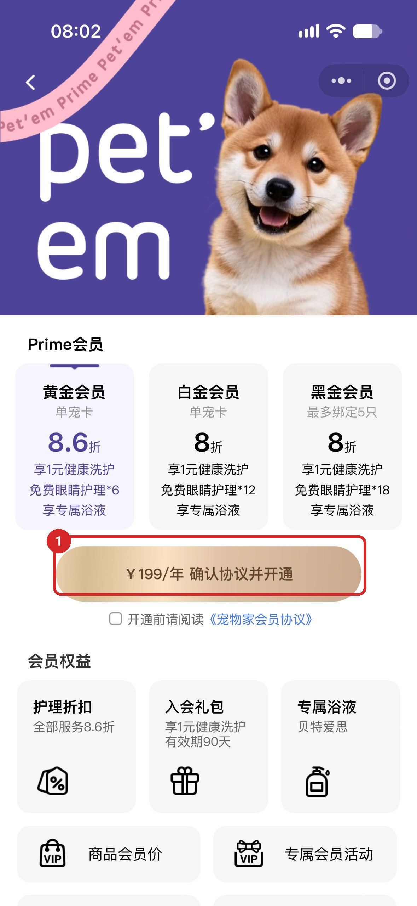

**这屏是什么**：顶部紫色大图（pet'em 字标 + 柴犬）；三档会员（黄金 8.6 折 / 白金 8 折 / 黑金 8 折，均为"单宠卡"或"最多绑定 5 只"）；权益列（1 元健康洗护、免费眼睛护理 ×6/×12/×18、专属浴液）；「¥199/年 确认协议并开通」；下方"会员权益"六宫格（护理折扣、入会礼包、专属浴液、商品会员价、专属会员活动）。

**出口：** ① ¥199 开通 → ⚠️ 缺图（支付页）

> 🏠 **给你的店**
> **不做年费会员。** 宠物家卖 199 年费，是因为它有几百家店、一年能洗 20 次；你的客户一年寄养 2–3 次，年费制算不过账。
> 换成**次卡**：充 10 晚送 1 晚（或直接卖"10 晚卡"）。理由：次卡卖的是**可交付的夜晚**，不是"资格"；一旦店不做了，剩下几晚按比例退，说得清。
> ⚠️ **合规提醒**：预充值余额型卡（E 卡那种）属于单用途预付卡，涉及备案与资金监管；次卡按"服务次数"交付，风险小得多。**具体口径请向属地商务部门确认，我给的是方向不是结论。**

---

## 9. 分期：P0 只做三件事

| 阶段 | 内容 | 页面数 | 判断标准 |
|---|---|---|---|
| **P0** | 首页（极简）、我的宠物、建立档案、预约寄养、订单列表 + 详情、店主确认、每日日报、微信客服入口 | 8 | 一个 50 岁客户不问人，60 秒内订上；你每天 30 秒发完日报 |
| **P1** | 次卡（10 晚卡）、评价、入住日历、疫苗到期提醒 | 4 | 有回头客了，再谈锁客 |
| **P2** | 发票、数据看板、优惠活动 | 2 | 月单量稳定过 20 单 |
| **不做** | 商城、内容社区、会员等级、储值 E 卡、在线支付、多门店、自建 IM | — | 永远不做，或至少今年不做 |

**给外包的报价要求**：P0 / P1 / P2 分三张表报价，P0 单列工期。不接受"打包价"——打包价最后一定是 P0 被做成 P2 的质量。

---

## 10. 功能取舍总表

| 宠物家的功能 | 你店 | 理由 |
|---|---|---|
| 门店选择 + 地图 | ❌ 砍 | 一家店，做选址只会让人以为你有分店 |
| 宝贝关爱日历（提醒） | 🔄 改 | 改成"本周剩余位置"，卖库存不卖复购 |
| 星光美容师（卖人） | 🔄 改 | 改成"照顾你狗的人"，一人店就把自己放上去 |
| 四宫格卖货入口 | ❌ 砍 | 三个是卖货，你一个都不开 |
| 内容流 / 资讯 | ❌ 砍 | 无内容产能，写三条就断更 |
| 领券中心 | ❌ 砍 | 没有券可发，也没有跨店补贴 |
| 服务货架（9 品类 + 套餐卡） | ❌ 砍 | 你只卖寄养一个 SKU |
| 套餐加购"＋" | ❌ 砍 | 寄养不是多件商品 |
| 订单页一级 tab（4 个） | 🔄 改 | 只留 寄养 / 次卡 |
| 订单状态（待支付/待服务/待评价） | 🔄 改 | 改成 待确认/待入住/入住中/已完成/已取消 |
| 建档：肩高、毛色 | 🔄 改 | 换成体重、疫苗本、性格、喂食、病史 |
| 建档：一次性填 8 项 | 🔄 改 | 拆两步：下单 4 项，接宠前补齐 |
| 养宠动态（社区） | ✅ 留（改用途） | 当每日日报的时间线用 |
| 宠物日历 | ✅ 留（改用途） | 当"我家狗在店哪几天"用 |
| 发票中心（4 屏） | ❌ 砍 | 一年几单，微信发票即可 |
| 反馈与建议（3 tab） | 🔄 合 | 合成一页"联系店主" |
| 系统设置（7 项） | 🔄 减 | 留 3 项，但隐私政策 + 注销账号必须有 |
| 微信客服会话 | ✅ 留 | 用原生能力，不自建 |
| Prime 年费会员 | ❌ 砍 | 年费制对低频客户算不过账 |
| E 卡 / 储值 | ❌ 砍 | 单用途预付卡有备案与资金风险 |
| 次卡 | ➕ 加 | 卖"10 个夜晚"，可交付、可退 |
| 在线支付 | ❌ P0 不做 | 商户号/退款/对账，人工确认更省 |
| 每日日报 | ➕ 加 | 竞品没有，这是寄养的核心体验 |
| 到店核销 | ➕ 加 | 竞品是到店洗美，没有履约环节 |

---

## 11. 建议补拍清单

按这个顺序补，每张只拍一屏，拍完用原文件名丢回 petem-wechat-mini-program-ui/ 目录。

1. **服务详情页**：S07 点第一张套餐卡（清凉防蚊洗护套餐）后跳到的页面。
2. **下单页**：在详情页点「立即预约」后，填写宠物/时间的页面。
3. **支付页**：随便下一单，停在支付前（不用真付）。
4. **预约成功页**：付完或取消前的那一屏。
5. **选宠物页**：S07 点「选择服务宠物」弹出的列表。
6. **订单详情**：有订单时（可让朋友下单，或自己下一单）点进订单列表某一单。
7. **我的评价**：S12 点「我的评价」。
8. **账单**：S12 点「账单」。
9. **驱虫计划**：S14 点「驱虫计划 ›」。
10. **首页 AI / 相机入口**：S01 日历左右两个小图标点开后的页面。

> 如果这 10 张都补不到也不要紧——文档里已经用**建议稿**填上了。补拍的价值是让外包看到"竞品真实长什么样"，而不是让我猜。

---

## 附录 A｜截屏索引

| 编号 | 原文件 | 页面 | 章节 |
|---|---|---|---|
| S01 | IMG_3352.jpeg | 首页·顶部 | 3.1 |
| S02 | IMG_3353.jpeg | 首页·中段 | 3.1 |
| S03 | IMG_3354.jpeg | 首页·下段 | 3.1 |
| S04 | IMG_3355.jpeg | 门店与地址选择 | 3.2 |
| S05 | IMG_3362.jpeg | 管理宠物（空态） | 4.1 |
| S06 | IMG_3363.jpeg | 建立档案（表单） | 4.2 |
| S07 | IMG_3356.jpeg | 服务·预约服务 | 5.1 |
| S08 | IMG_3357.jpeg | 服务·我的服务 | 5.1 |
| S09 | IMG_3358.jpeg | 订单·服务 | 5.2 |
| S10 | IMG_3359.jpeg | 订单·卡券 | 5.2 |
| S11 | IMG_3360.jpeg | 订单·寄养 | 5.2 |
| S12 | IMG_3361.jpeg | 我的 | 8.1 |
| S13 | IMG_3364.jpeg | 养宠动态 | 8.2 |
| S14 | IMG_3365.jpeg | 宠物日历 | 8.3 |
| S15 | IMG_3366.jpeg | 发票中心 | 8.4 |
| S16 | IMG_3370.jpeg | 开票列表·宠物护理 | 8.4 |
| S17 | IMG_3371.jpeg | 开票列表·E 卡 | 8.4 |
| S18 | IMG_3372.jpeg | 开票历史 | 8.4 |
| S19 | IMG_3373.jpeg | 发票须知 | 8.4 |
| S20 | IMG_3367.jpeg | 反馈·意见反馈 | 8.5 |
| S21 | IMG_3368.jpeg | 反馈·投诉订单 | 8.5 |
| S22 | IMG_3369.jpeg | 反馈·投诉客服 | 8.5 |
| S23 | IMG_3374.jpeg | 系统设置 | 8.6 |
| S24 | IMG_3375.jpeg | 客服会话 | 8.7 |
| S25 | IMG_3376.jpeg | Prime 会员 | 8.8 |

> 本文档引用的图在 petem-annotated/（红框标注版）；原图在 petem-wechat-mini-program-ui/。

---

## 附录 B｜P0 数据字段

**宠物**
编号 / 主人 openid / 照片 / 名字 / 品种 / 性别 / 生日 / 体重(kg，计价用) / 疫苗照片 / 疫苗有效期 / 是否绝育 / 性格标签 / 喂食说明 / 病史与用药 / 紧急联系人 / 建档时间

**订单**
订单号 / 宠物编号 / 入住日 / 离店日 / 晚数 / 单价 / 预估金额 / 实收金额 / 接送(布尔) / 接送地址 / 备注 / 状态 / 店主确认时间 / 入住时间 / 离店时间 / 创建时间

**日报**
编号 / 订单号 / 日期 / 模板(吃得好像/有点紧张/玩得开心) / 照片(最多3) / 一句话 / 发送时间

> 字段不是越多越好：每多一个字段，外包多一次联调，你多一次填错的机会。

---

## 附录 C｜P0 验收标准

| 页面 | 验收（三条，现场演示） |
|---|---|
| 首页 | ① 未建档时首屏能直接点「建档」；② 有档案时首屏能直接点「预约」；③ 底部 3 个 tab + 悬浮按钮点击正常，无 404 页 |
| 我的宠物 | ① 空态有「添加宠物」按钮；② 多宠物时列表可切换；③ 点某只宠物能改资料 |
| 建立档案 | ① 4 个必填项不填不能保存；② 能上传疫苗照片并成功回显；③ 保存后 3 秒内回到列表且出现新宠物 |
| 预约寄养 | ① 选入住/离店后自动算出晚数与金额，且金额 = 体重单价 × 晚数；② 未建档时点预约会跳建档，填完能回到预约页；③ 提交后生成"待确认"订单并跳成功页 |
| 订单列表 | ① 5 个状态 tab 都能筛出对应订单；② 空态有 CTA；③ 下拉能刷新出新订单 |
| 订单详情 | ① 显示状态、金额、地址、注意事项；② 「联系店主」能进客服；③ 待确认时可取消 |
| 店主确认 | ① 新订单有微信订阅消息推送；② 能确认 / 改价 / 拒绝；③ 客户侧状态实时更新 |
| 每日日报 | ① 选模板 + 选 3 张图 ≤ 30 秒发完；② 客户侧按日期形成时间线；③ 发送后客户收到订阅消息 |

---

*本文档由 25 张实拍截屏 + 6 轮澄清整理而成。截屏仅用于说明信息结构，界面元素、文案、图标、配色均需重做，不得临摹。*
